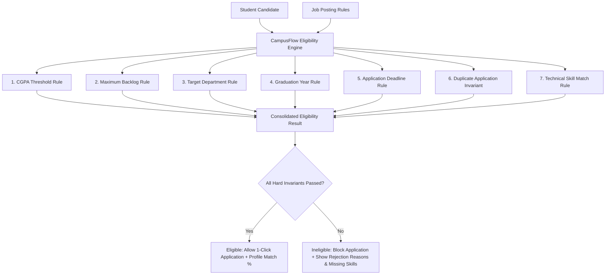

# CampusFlow – Smart Campus Placement & Recruitment Management Platform

[](https://openjdk.org/projects/jdk/21/)
[](https://spring.io/projects/spring-boot)
[](https://react.dev/)
[](https://vitejs.dev/)
[](https://tailwindcss.com/)
[](https://www.mysql.com/)
[](https://redis.io/)
[](https://www.docker.com/)

**CampusFlow** is an enterprise-grade full-stack web platform designed to digitize and automate the entire campus recruitment lifecycle. It replaces disjointed spreadsheets, manual communication channels, and physical notice boards with an integrated, secure, role-based ecosystem connecting **Students**, **Corporate Recruiters**, **Placement Officers**, and **System Administrators**.

---

## 🌟 Key Functional Highlights

### 1. 🎓 Student Placement Portal
- **Profile & Academic Management**: USN, college, department, graduation year, verified CGPA, active backlog tracking, and technical skills.
- **Resume Upload & Validation**: Secure PDF/DOC upload with MIME and size validation (up to 5MB), stored outside publicly executable web directories.
- **Dynamic Eligibility Pre-Screening**: Instantly view eligibility breakdown for any job before applying—including profile match scores, institutional requirement passes/fails, and matched vs. missing skills.
- **1-Click Application & Tracking**: Submit applications with atomic server-side validation and track progress across applied, shortlisted, interview, and offer stages.
- **Interview Hub**: Track upcoming technical and HR interview rounds with direct video meeting links and recruiter instructions.
- **Offer Desk**: Review detailed formal job offers (package in LPA, joining dates, notes) and accept or reject offers in-app.

### 2. 🏢 Recruiter Pipeline & Candidate Management
- **Company & Recruiter Verification**: Recruiter accounts require verified corporate domains and placement officer approval before unlocking job posting capabilities.
- **Flexible Job Creation**: Define custom eligibility criteria (minimum CGPA, maximum backlogs, target departments, graduation years, required skills, and deadlines).
- **Candidate Shortlisting & Screening**: Review applicants, filter by status, inspect student resumes, and transition candidate states.
- **Multi-Round Interview Scheduling**: Schedule Aptitude, Technical, and HR rounds with dates, times, Google Meet/Teams links, and interviewer feedback.
- **Offer Issuance**: Generate formal job offers with compensation packages and acceptance deadlines.

### 3. 🏛️ Placement Officer Command Center
- **Executive Analytics Dashboard**: Real-time aggregated statistics calculated directly from the database (total students, verified rate, placed students, average package, highest package, placement percentage).
- **Interactive Recharts Visualizations**: Department-wise placement rate bar charts and top recruiting corporate partners breakdown.
- **Recruiter Approvals**: Review and approve/reject company and recruiter registrations.
- **Academic Verification**: Review student records and mark academic details as verified, locking student marksheets from unauthorized tampering.
- **Institutional Placement Drives**: Create and govern campus-wide recruitment drives with defined calendar dates and student targets.
- **One-Click CSV Export**: Generate official institutional placement reports formatted as CSV for university accreditation and NIRF reporting.

### 4. 🛡️ System Administration & Governance
- **Global User & Role Management**: Manage user accounts and activate/deactivate credentials.
- **Department Master Data**: Configure and update academic departments and discipline codes.
- **Immutable Security Audit Trail**: Asynchronous transactional logging of critical platform events (`LOGIN`, `JOB_CREATE`, `STATUS_CHANGE`, `OFFER_ISSUE`) with IP address logging.

---

## 🧠 Dynamic Eligibility Engine

CampusFlow replaces simple boolean checks with an extensible, rule-based **Dynamic Eligibility Engine**. When a student views or applies for a job, the engine evaluates candidate parameters against job constraints and returns a comprehensive evaluation response:



### Sample Eligibility Evaluation JSON Payload
```json
{
  "eligible": true,
  "matchScorePercentage": 92.5,
  "criteriaBreakdown": [
    { "criterion": "Minimum CGPA", "passed": true, "requirement": ">= 7.5", "studentValue": "8.85" },
    { "criterion": "Active Backlogs", "passed": true, "requirement": "<= 0", "studentValue": "0" },
    { "criterion": "Department", "passed": true, "requirement": "CSE, ISE, AIML", "studentValue": "Computer Science and Engineering" },
    { "criterion": "Graduation Year", "passed": true, "requirement": "2026", "studentValue": "2026" },
    { "criterion": "Application Deadline", "passed": true, "requirement": "Before 2026-12-15T23:59:59", "studentValue": "Current Date Valid" },
    { "criterion": "Application History", "passed": true, "requirement": "Single Application Invariant", "studentValue": "Not yet applied" }
  ],
  "rejectionReasons": [],
  "matchedSkills": ["Java", "Spring Boot", "React", "SQL"],
  "missingSkills": ["Docker"]
}
```

---

## 🏗️ System Architecture

```
                                  [ Browser / Client ]
                                           |
                                    (HTTP Port 80)
                                           v
                              +--------------------------+
                              |      Nginx Reverse       |
                              |   Proxy & Static SPA     |
                              +--------------------------+
                                  /                  \
                       (Static Assets)          (/api/* Reverse Proxy)
                                /                      \
                               v                        v
                    [ React 18 SPA Dist ]     [ Spring Boot 3 Backend:8080 ]
                                                       |
                              +------------------------+------------------------+
                              |                        |                        |
                              v                        v                        v
                    [ Spring Security 6 ]      [ Dynamic Engine ]     [ Redis 7 Cache ]
                              |                        |
                              +------------------------+
                                           |
                                 (Spring Data JPA)
                                           |
                                           v
                                [ MySQL 8.0 Database ]
                                (Flyway Migrations V1 & V2)
```

### Security & Invariants
- **Stateless JWT Authentication**: Tokens signed with HMAC-SHA256 (`HS256`) containing subject email, user ID, and role.
- **Role-Based Access Control**: Strict method-level checks (`@PreAuthorize`) and URL antMatchers.
- **Ownership Verification**: Recruiters can only access and modify their own company's jobs and candidates; students can only manage their own profile and view their own applications.
- **Database Unique Constraints**: `uq_job_student` prevents duplicate applications at the database engine level.
- **Optimistic Locking**: JPA `@Version` columns prevent concurrent overwrites during candidate status transitions.

---

## 🛠️ Technology Stack

| Layer | Technologies |
|---|---|
| **Backend** | Java 21 LTS, Spring Boot 3.3.4, Spring Web, Spring Data JPA, Hibernate ORM, Spring Security 6, Spring Boot Actuator, Flyway Migrations, Apache Commons CSV, Springdoc OpenAPI 2.6.0 |
| **Frontend** | React 18, Vite 5, Tailwind CSS 3, React Router v6, Axios, Recharts, Lucide React |
| **Database** | MySQL 8.0 (production/docker) / H2 in MySQL mode (local standalone/testing) |
| **Caching** | Redis 7 In-Memory Cache for job listings and dashboard metrics |
| **DevOps** | Multi-stage Dockerfiles, Docker Compose, GitHub Actions CI/CD pipeline |

---

## 🚀 Quick Start Guide

### Option A: 1-Click Launch with Docker Compose (Recommended)

Make sure [Docker Desktop](https://www.docker.com/products/docker-desktop/) is running, then execute:

```powershell
# Clone the repository and navigate into the workspace
git clone https://github.com/your-username/CampusFlow.git
cd CampusFlow

# Launch all 4 orchestrated containers (MySQL, Redis, Backend, Frontend)
docker compose up --build
```

Access the services:
- **Frontend Web Portal**: [http://localhost](http://localhost) (or [http://localhost:3000](http://localhost:3000))
- **Backend REST API**: [http://localhost:8081](http://localhost:8081)
- **Interactive Swagger UI**: [http://localhost:8081/swagger-ui.html](http://localhost:8081/swagger-ui.html)
- **Actuator Health Metrics**: [http://localhost:8081/actuator/health](http://localhost:8081/actuator/health)

---

### Option B: Local Standalone Development

#### 1. Backend Setup
The backend is configured with a zero-setup `local` profile using in-memory H2 in MySQL syntax mode with automatic Flyway V1 & V2 migrations.
```powershell
cd d:\CampusFlow\backend

# Ensure Java 21 is active
$env:JAVA_HOME = "C:\Program Files\Java\jdk-21.0.10"

# Compile and start Spring Boot (runs on port 8081 to avoid conflict with Jenkins on 8080)
mvn spring-boot:run
```

#### 2. Frontend Setup
```powershell
cd d:\CampusFlow\frontend

# Install dependencies (Node.js 20+)
npm install

# Start Vite development server (runs on port 5173 with proxy to 8081)
npm run dev
```
Open [http://localhost:5173](http://localhost:5173) in your browser.

---

## 👥 Pre-Seeded Demo User Accounts

All seed accounts use the default password: **`password123`**

| Role | Email | Full Name / Title | Description |
|---|---|---|---|
| 🎓 **Student** | `arjun.sharma@campusflow.com` | Arjun Sharma | High CGPA (8.85), 0 Backlogs, CSE Department, Has Resumes |
| 🎓 **Student** | `priya.nair@campusflow.com` | Priya Nair | CGPA 7.40, 1 Backlog, ISE Department, Tests partial eligibility |
| 🎓 **Student** | `rohit.verma@campusflow.com` | Rohit Verma | CGPA 6.80, 2 Backlogs, MECH Department, Tests ineligible edge cases |
| 🏢 **Recruiter** | `recruiter.google@campusflow.com` | Ananya Deshmukh | Approved Google Recruiter (SWE, SRE roles) |
| 🏢 **Recruiter** | `recruiter.msft@campusflow.com` | Vikramaditya Sen | Approved Microsoft Recruiter (Cloud Engineer roles) |
| 🏢 **Recruiter** | `recruiter.pending@campusflow.com` | Rohit Khandelwal | Pending Approval Recruiter (Tests officer approval flow) |
| 🏛️ **Placement Officer** | `officer@campusflow.com` | Dr. Rajesh Rao | Placement Head with verification & report powers |
| 🛡️ **System Admin** | `admin@campusflow.com` | System Administrator | Full platform access, audit logs, department management |

> **Pro-Tip**: The login page (`/login`) includes 1-click **Demo Account Switcher** buttons. Clicking any role instantly pre-populates credentials and logs in.

---

## 🧪 Testing & Verification

### Running Backend Automated Tests
```powershell
$env:JAVA_HOME = "C:\Program Files\Java\jdk-21.0.10"
cd d:\CampusFlow\backend
mvn test
```
*Executes unit and integration test suites: `EligibilityEngineTest`, `AuthServiceTest`, `ApplicationServiceTest`, `AuthControllerIntegrationTest`, and `BCryptTest`.*

### Building Frontend Production Bundle
```powershell
cd d:\CampusFlow\frontend
npm run build
```
*Compiles and bundles the React 18 SPA with Vite into `dist/` with zero errors.*

---

## 📂 Repository Directory Layout

```
CampusFlow/
├── .github/
│   └── workflows/
│       └── ci.yml                     # GitHub Actions CI/CD Pipeline
├── backend/
│   ├── src/
│   │   ├── main/
│   │   │   ├── java/com/campusflow/
│   │   │   │   ├── config/            # Security, OpenAPI, Web MVC configs
│   │   │   │   ├── controller/        # 12 REST API Controllers
│   │   │   │   ├── dto/               # Request & Response DTOs + EntityMapper
│   │   │   │   ├── entity/            # 13 JPA Entities with Auditing & Versioning
│   │   │   │   ├── exception/         # RestControllerAdvice & Custom Exceptions
│   │   │   │   ├── repository/        # 13 Spring Data JPA Repositories
│   │   │   │   ├── security/          # JWT Filters, Token Provider, UserDetails
│   │   │   │   └── service/           # Domain Services + Eligibility Engine
│   │   │   └── resources/
│   │   │       ├── db/migration/      # Flyway V1 (Schema) & V2 (Seed Data)
│   │   │       └── application*.yml   # Configuration profiles (local, dev, docker)
│   │   └── test/                      # Unit & MockMvc Integration Test Suites
│   ├── Dockerfile                     # Multi-stage Maven/Java 21 Build
│   └── pom.xml                        # Maven Dependencies & Plugins
├── frontend/
│   ├── src/
│   │   ├── components/                # Modals, Eligibility Dialogs, Status Badges
│   │   ├── context/                   # AuthContext, ToastContext
│   │   ├── layouts/                   # DashboardLayout, Sidebar, Navbar
│   │   ├── pages/                     # Student, Recruiter, Officer, Admin Portals
│   │   ├── routes/                    # AppRoutes & Role-Protected Routes
│   │   └── services/                  # Axios API Client with Auto-Auth Interceptor
│   ├── Dockerfile                     # Multi-stage Node/Nginx Build
│   ├── nginx.conf                     # Nginx Reverse Proxy & SPA Fallback
│   ├── package.json                   # React 18, Vite, Tailwind Dependencies
│   └── vite.config.js                 # Dev Server & Proxy Configuration
├── docs/
│   ├── api-documentation.md           # Complete REST API Endpoint Specification
│   ├── database-design.md             # Mermaid ER Diagram & Relational Schemas
│   └── testing.md                     # Test Suite Architecture & Manual Walkthroughs
├── ARCHITECTURE.md                    # System Architecture & Design Patterns
├── DEVELOPMENT_PLAN.md                # Phased Milestone Execution Checklist
├── docker-compose.yml                 # Multi-Container Compose Orchestration
└── README.md                          # Master Project Documentation
```

---

## 📄 License & Attribution

Designed and engineered for enterprise campus placement operations. Open source under the [MIT License](LICENSE).

