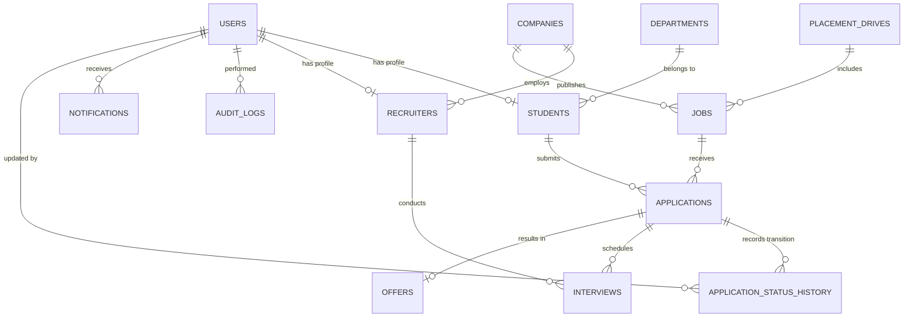

# CampusFlow - Database Design & Schema Documentation

## 1. Entity-Relationship Overview

---

## 2. Relational Table Specifications

### 2.1 `users`
| Column | Type | Constraints | Description |
|---|---|---|---|
| `id` | BIGINT | PRIMARY KEY, AUTO_INCREMENT | Unique identifier |
| `email` | VARCHAR(150) | UNIQUE, NOT NULL | Account login email |
| `password` | VARCHAR(255) | NOT NULL | BCrypt hashed password |
| `full_name` | VARCHAR(150) | NOT NULL | Display name |
| `phone` | VARCHAR(20) | NULL | Phone number |
| `role` | VARCHAR(30) | NOT NULL | STUDENT, RECRUITER, PLACEMENT_OFFICER, ADMIN |
| `is_active` | BOOLEAN | NOT NULL DEFAULT TRUE | Account state |
| `is_verified` | BOOLEAN | NOT NULL DEFAULT FALSE | Approval status (auto-true for students/officers) |
| `version` | BIGINT | NOT NULL DEFAULT 0 | Optimistic locking counter |
| `created_at` | DATETIME | NOT NULL | Record creation timestamp |
| `updated_at` | DATETIME | NOT NULL | Last update timestamp |

### 2.2 `departments`
| Column | Type | Constraints | Description |
|---|---|---|---|
| `id` | BIGINT | PRIMARY KEY, AUTO_INCREMENT | Dept ID |
| `code` | VARCHAR(20) | UNIQUE, NOT NULL | E.g. CSE, ISE, ECE, MECH, AIML |
| `name` | VARCHAR(100) | NOT NULL | Full department title |
| `is_active` | BOOLEAN | NOT NULL DEFAULT TRUE | Available for selection |

### 2.3 `students`
| Column | Type | Constraints | Description |
|---|---|---|---|
| `id` | BIGINT | PRIMARY KEY, AUTO_INCREMENT | Student ID |
| `user_id` | BIGINT | UNIQUE, NOT NULL, FK(`users.id`) | Linked authentication user |
| `usn` | VARCHAR(50) | UNIQUE, NOT NULL | University Seat Number |
| `department_id` | BIGINT | NOT NULL, FK(`departments.id`) | Academic department |
| `college_name` | VARCHAR(150) | NOT NULL | College / Institute name |
| `graduation_year` | INT | NOT NULL | Graduation batch year (e.g. 2027) |
| `current_cgpa` | DECIMAL(4,2) | NOT NULL | CGPA on 10.0 scale |
| `backlog_count` | INT | NOT NULL DEFAULT 0 | Current active backlogs |
| `skills` | TEXT | NULL | Comma-delimited list of technical skills |
| `resume_url` | VARCHAR(255) | NULL | Relative path/URL to uploaded resume |
| `profile_photo_url` | VARCHAR(255) | NULL | Profile image path/URL |
| `is_placed` | BOOLEAN | NOT NULL DEFAULT FALSE | Placement flag |
| `version` | BIGINT | NOT NULL DEFAULT 0 | Optimistic locking |

### 2.4 `companies`
| Column | Type | Constraints | Description |
|---|---|---|---|
| `id` | BIGINT | PRIMARY KEY, AUTO_INCREMENT | Company ID |
| `name` | VARCHAR(150) | UNIQUE, NOT NULL | Corporate legal/brand name |
| `website` | VARCHAR(255) | NULL | Company website URL |
| `industry` | VARCHAR(100) | NULL | Domain (e.g., Software, FinTech) |
| `location` | VARCHAR(150) | NULL | Headquarters / Office location |
| `description` | TEXT | NULL | Company background overview |
| `is_verified` | BOOLEAN | NOT NULL DEFAULT FALSE | Verified by Placement Officer |
| `created_at` | DATETIME | NOT NULL | Registration date |
| `updated_at` | DATETIME | NOT NULL | Update date |

### 2.5 `recruiters`
| Column | Type | Constraints | Description |
|---|---|---|---|
| `id` | BIGINT | PRIMARY KEY, AUTO_INCREMENT | Recruiter ID |
| `user_id` | BIGINT | UNIQUE, NOT NULL, FK(`users.id`) | Linked user account |
| `company_id` | BIGINT | NOT NULL, FK(`companies.id`) | Associated enterprise |
| `designation` | VARCHAR(100) | NULL | E.g., Lead Talent Acquisition |
| `is_approved` | BOOLEAN | NOT NULL DEFAULT FALSE | Authorized by Placement Officer |
| `version` | BIGINT | NOT NULL DEFAULT 0 | Optimistic locking |

### 2.6 `placement_drives`
| Column | Type | Constraints | Description |
|---|---|---|---|
| `id` | BIGINT | PRIMARY KEY, AUTO_INCREMENT | Drive ID |
| `title` | VARCHAR(150) | NOT NULL | E.g., Campus Placement Season 2026-27 |
| `academic_year` | VARCHAR(20) | NOT NULL | Academic year session |
| `start_date` | DATE | NOT NULL | Drive commencement |
| `end_date` | DATE | NOT NULL | Drive closure |
| `status` | VARCHAR(30) | NOT NULL | UPCOMING, ONGOING, COMPLETED, CANCELLED |
| `description` | TEXT | NULL | Additional instructions |

### 2.7 `jobs`
| Column | Type | Constraints | Description |
|---|---|---|---|
| `id` | BIGINT | PRIMARY KEY, AUTO_INCREMENT | Job opening ID |
| `company_id` | BIGINT | NOT NULL, FK(`companies.id`) | Hiring company |
| `placement_drive_id` | BIGINT | NULL, FK(`placement_drives.id`)| Associated placement drive |
| `created_by_recruiter_id` | BIGINT | NOT NULL, FK(`recruiters.id`) | Publishing recruiter |
| `title` | VARCHAR(150) | NOT NULL | Job role title |
| `description` | TEXT | NOT NULL | Role description and responsibilities |
| `job_type` | VARCHAR(50) | NOT NULL | Full-time, Internship, FTE+Intern |
| `location` | VARCHAR(100) | NOT NULL | Work location (Bangalore, Remote, etc.) |
| `salary_package` | VARCHAR(50) | NOT NULL | E.g. "12 LPA", "8.5 LPA" |
| `min_cgpa` | DECIMAL(4,2) | NOT NULL DEFAULT 0.00 | Minimum qualifying CGPA |
| `max_backlogs` | INT | NOT NULL DEFAULT 0 | Maximum allowable active backlogs |
| `eligible_departments` | VARCHAR(255) | NOT NULL | Comma-separated dept codes (CSE, ISE) |
| `graduation_year` | INT | NOT NULL | Qualifying batch |
| `required_skills` | TEXT | NULL | Comma-delimited skill prerequisites |
| `application_deadline` | DATETIME | NOT NULL | Deadline timestamp |
| `status` | VARCHAR(30) | NOT NULL | DRAFT, PUBLISHED, CLOSED, CANCELLED |
| `version` | BIGINT | NOT NULL DEFAULT 0 | Optimistic locking |
| `created_at` | DATETIME | NOT NULL | Creation timestamp |
| `updated_at` | DATETIME | NOT NULL | Modification timestamp |

### 2.8 `applications`
| Column | Type | Constraints | Description |
|---|---|---|---|
| `id` | BIGINT | PRIMARY KEY, AUTO_INCREMENT | Application ID |
| `job_id` | BIGINT | NOT NULL, FK(`jobs.id`) | Applied job |
| `student_id` | BIGINT | NOT NULL, FK(`students.id`) | Applying candidate |
| `status` | VARCHAR(30) | NOT NULL | APPLIED, UNDER_REVIEW, SHORTLISTED, INTERVIEW_SCHEDULED, SELECTED, REJECTED, WITHDRAWN |
| `applied_at` | DATETIME | NOT NULL | Submission time |
| `reviewed_at` | DATETIME | NULL | Last recruiter action time |
| `notes` | TEXT | NULL | Recruiter internal review notes |
| `version` | BIGINT | NOT NULL DEFAULT 0 | Optimistic locking |
| **CONSTRAINT** | `uq_job_student` | UNIQUE(`job_id`, `student_id`) | Strict duplicate prevention |

### 2.9 `application_status_history`
| Column | Type | Constraints | Description |
|---|---|---|---|
| `id` | BIGINT | PRIMARY KEY, AUTO_INCREMENT | History ID |
| `application_id` | BIGINT | NOT NULL, FK(`applications.id`) | Target application |
| `from_status` | VARCHAR(30) | NULL | Previous state |
| `to_status` | VARCHAR(30) | NOT NULL | Transitioned state |
| `changed_by_user_id`| BIGINT | NOT NULL, FK(`users.id`) | Actor making the change |
| `comment` | TEXT | NULL | Rationale for transition |
| `changed_at` | DATETIME | NOT NULL | Event timestamp |

### 2.10 `interviews`
| Column | Type | Constraints | Description |
|---|---|---|---|
| `id` | BIGINT | PRIMARY KEY, AUTO_INCREMENT | Interview ID |
| `application_id` | BIGINT | NOT NULL, FK(`applications.id`) | Linked application |
| `conducted_by_recruiter_id` | BIGINT | NOT NULL, FK(`recruiters.id`) | Assigned recruiter |
| `round_name` | VARCHAR(50) | NOT NULL | APTITUDE, TECH_1, TECH_2, HR, FINAL |
| `scheduled_at` | DATETIME | NOT NULL | Interview slot |
| `mode` | VARCHAR(20) | NOT NULL | ONLINE, IN_PERSON |
| `location_or_link` | VARCHAR(255) | NOT NULL | Meeting URL or Campus Room |
| `instructions` | TEXT | NULL | Special candidate preparation notes |
| `status` | VARCHAR(30) | NOT NULL | SCHEDULED, COMPLETED, CANCELLED, RESCHEDULED |
| `feedback` | TEXT | NULL | Interviewer evaluation notes |
| `version` | BIGINT | NOT NULL DEFAULT 0 | Optimistic locking |

### 2.11 `offers`
| Column | Type | Constraints | Description |
|---|---|---|---|
| `id` | BIGINT | PRIMARY KEY, AUTO_INCREMENT | Offer ID |
| `application_id` | BIGINT | UNIQUE, NOT NULL, FK(`applications.id`) | Associated selected application |
| `job_designation` | VARCHAR(150) | NOT NULL | Offered role title |
| `salary_package` | VARCHAR(100) | NOT NULL | Confirmed compensation package |
| `joining_date` | DATE | NOT NULL | Expected date of joining |
| `offer_expiration_date` | DATE | NOT NULL | Candidate response deadline |
| `status` | VARCHAR(30) | NOT NULL | OFFERED, ACCEPTED, REJECTED, EXPIRED |
| `offer_letter_url` | VARCHAR(255) | NULL | Document download path |
| `issued_at` | DATETIME | NOT NULL | Offer dispatch timestamp |
| `responded_at` | DATETIME | NULL | Candidate action timestamp |
| `version` | BIGINT | NOT NULL DEFAULT 0 | Optimistic locking |

### 2.12 `notifications`
| Column | Type | Constraints | Description |
|---|---|---|---|
| `id` | BIGINT | PRIMARY KEY, AUTO_INCREMENT | Notification ID |
| `recipient_user_id`| BIGINT | NOT NULL, FK(`users.id`) | Target user |
| `title` | VARCHAR(200) | NOT NULL | Notification headline |
| `message` | TEXT | NOT NULL | Detailed message body |
| `type` | VARCHAR(50) | NOT NULL | Category enum/code |
| `reference_id` | BIGINT | NULL | Context ID (job, application, offer) |
| `is_read` | BOOLEAN | NOT NULL DEFAULT FALSE | Read state indicator |
| `created_at` | DATETIME | NOT NULL | Generation time |

### 2.13 `audit_logs`
| Column | Type | Constraints | Description |
|---|---|---|---|
| `id` | BIGINT | PRIMARY KEY, AUTO_INCREMENT | Audit record ID |
| `user_id` | BIGINT | NULL | Actor ID (null if system/anonymous) |
| `user_email` | VARCHAR(150) | NULL | Actor email |
| `action` | VARCHAR(100) | NOT NULL | E.g. USER_LOGIN, JOB_PUBLISH, STATUS_CHANGE |
| `entity_type` | VARCHAR(50) | NOT NULL | Target entity (JOB, APPLICATION, OFFER) |
| `entity_id` | VARCHAR(50) | NULL | ID of target entity |
| `description` | TEXT | NOT NULL | Human-readable audit narrative |
| `ip_address` | VARCHAR(50) | NULL | Client remote IP |
| `timestamp` | DATETIME | NOT NULL | Event timestamp |

